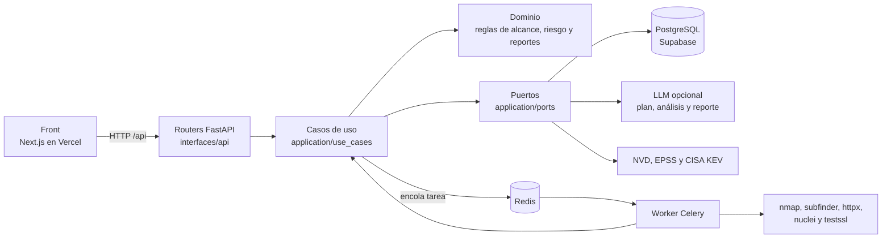

# SafeIT Back - Arquitectura

Arquitectura hexagonal: el **dominio** contiene las reglas (alcance, riesgo, reportes) y no depende de nada externo. Los **casos de uso** orquestan el flujo y hablan con el exterior solo mediante **puertos**; la capa de **infraestructura** implementa esos puertos (PostgreSQL, LLM, feeds de CVE, herramientas y Redis). Los escaneos largos se encolan en Redis y los ejecuta un worker de Celery.

## Más información

- [About](ABOUT.md)
- [README](README.md)
